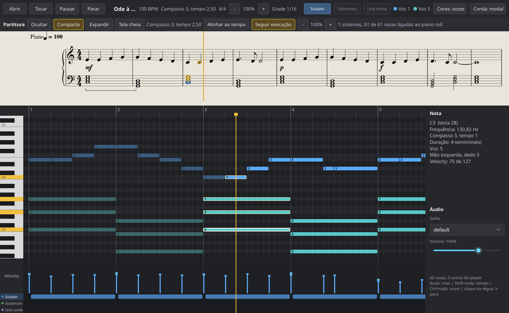
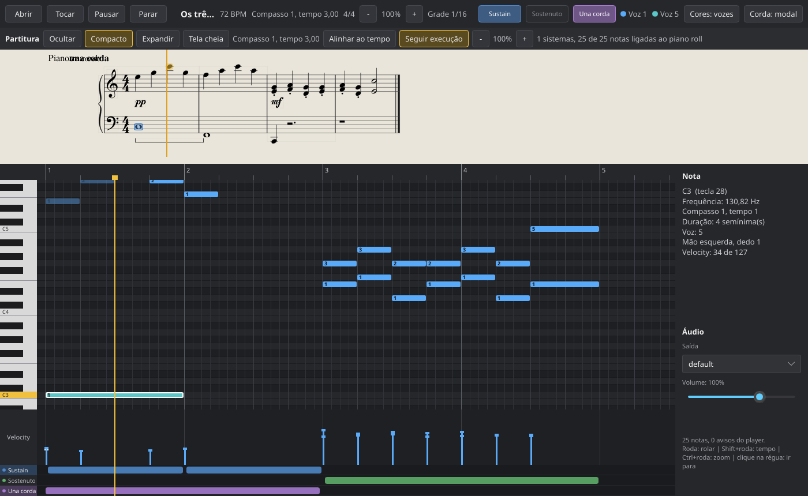
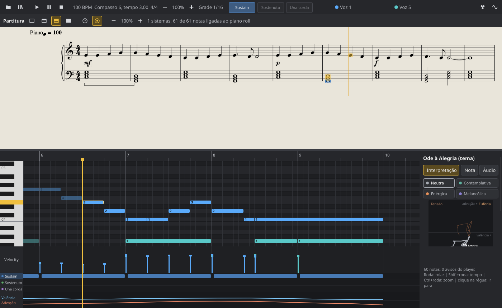
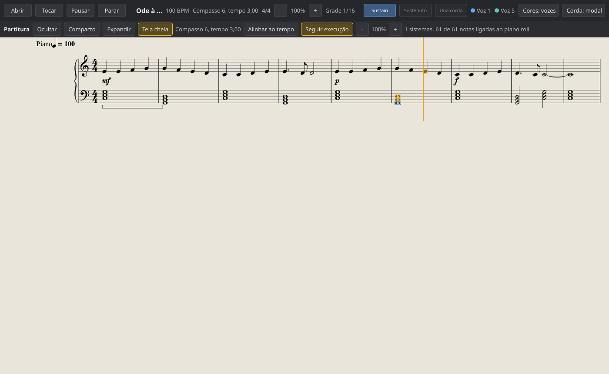
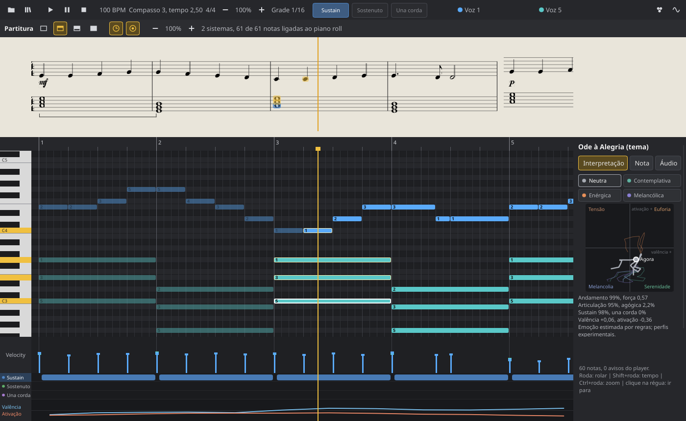
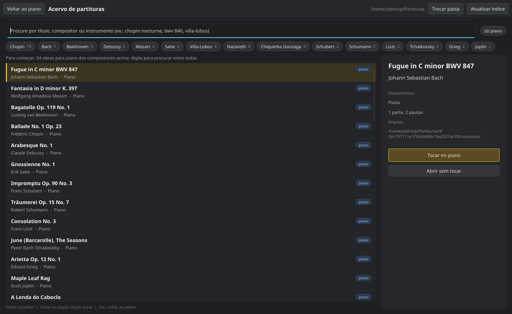
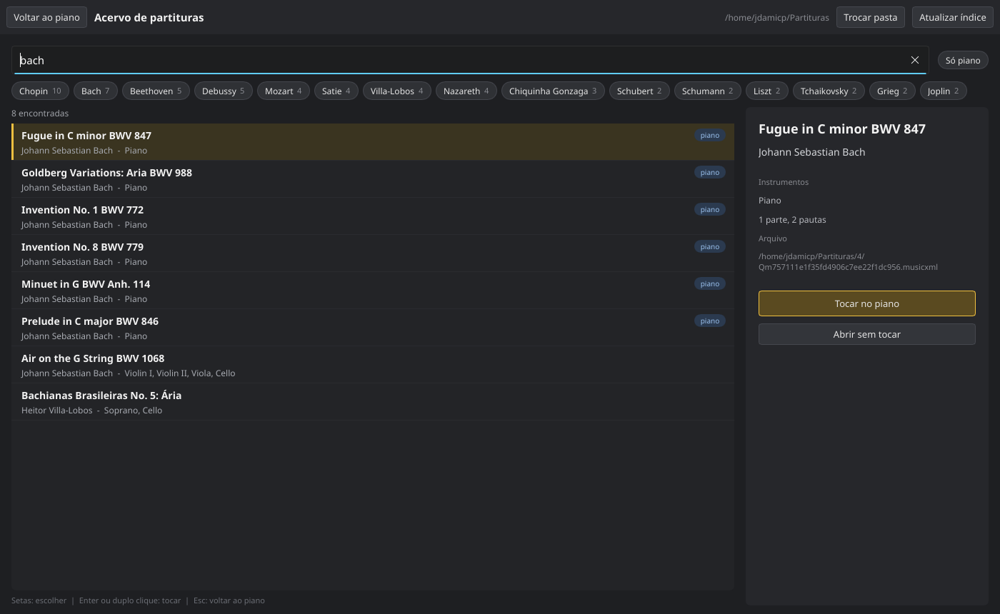
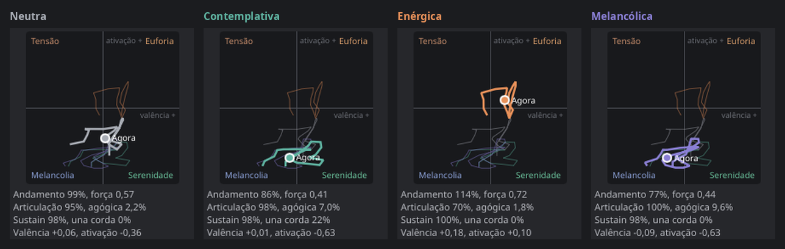

# Canção: Um piano digital por modelagem física

Sintetiza as 88 teclas de um piano (A0-C8) a partir da física da corda:

    f = (1 / 2L) * √(T / μ)

Cada corda tem comprimento `L`, massa linear `μ` e diâmetro plausíveis para
um piano de cauda. A tensão `T` sai da afinação, como faz um afinador, e a
frequência que soa é calculada pela fórmula. A rigidez do aço dá a
inarmonicidade dos parciais: `f_n = n*f*√(1 + B*n²)`, com
`B = π³*E*d⁴ / (64*T*L²)`.

O protótipo original em C está em [`c_sandbox/`](c_sandbox/), incluindo a
investigação do travamento do driver de áudio do notebook
([Áudio: latência, driver e hardware](c_sandbox/README.md#áudio-latência-driver-e-hardware)).

## Plataformas

Foco em Linux (Ubuntu) e macOS; Windows em segundo plano. A saída de
áudio usa `cpal`, que cobre ALSA/PipeWire/JACK, CoreAudio e WASAPI. A
interface gráfica será feita em [Slint](https://slint.dev).

## Compilar

    sudo apt install libasound2-dev libfontconfig1-dev pkg-config   # só no Linux, uma vez
    cargo build --release
    cargo test --release

Sem a interface gráfica (dispensa o `libfontconfig1-dev`):

    cargo build --release --no-default-features --features audio

Sem os headers do ALSA, dá para compilar só a parte offline
(`--tabela`, `--render`, `--bench`):

    cargo build --release --no-default-features

## Tocar um MusicXML (início rápido)

    cargo build --release
    ./target/release/piano --musicxml exemplos/ode.musicxml

O player toca o tema da *Ode à Alegria* (Beethoven, domínio público) com as
duas mãos e mostra, para cada momento, a mão (`MD`/`ME`) e o dedo de cada
nota (1 = polegar ... 5 = mínimo):

    Ode à Alegria (tema)  (humanização 0.5)
        0.0 s  ME C3(5) E3(3) G3(1)
        0.0 s  MD E4(2)
        0.6 s  MD E4(2)
        1.3 s  MD F4(3)
        ...

Variações úteis:

    ./target/release/piano --musicxml exemplos/ode.musicxml --modelo guia      # corda em guia de onda
    ./target/release/piano --musicxml exemplos/ode.musicxml --humanizar 0      # tempos exatos
    ./target/release/piano --musicxml exemplos/ode.musicxml --render ode.wav   # grava WAV, sem placa de som

Qualquer arquivo `.musicxml`, `.xml` ou `.mxl` funciona, dentro do recorte
descrito em [MusicXML](#musicxml). O exemplo `exemplos/pedais.musicxml` usa
os três pedais (una corda e sustain em pp, depois o sostenuto segurando um
Dó grave enquanto a direita toca staccato):

    ./target/release/piano --gui --musicxml exemplos/pedais.musicxml

## Interface: piano roll

    ./target/release/piano --gui                               # abre exemplos/ode.musicxml
    ./target/release/piano --gui --musicxml arq.musicxml       # qualquer MusicXML
    ./target/release/piano --gui --partitura acordes           # exemplos embutidos

Visualizador temporal da partitura tocada pelo player, inspirado no piano
roll de DAWs, em [Slint](https://slint.dev):

- barra superior: ícones pequenos para abrir, acervo, tocar, pausar,
  parar, zoom, cores por voz ou por mão e modelo de corda (o nome de cada
  ícone aparece na barra ao passar o mouse), andamento, posição (compasso e
  tempo), fórmula de compasso, grade, luzes dos três pedais e legenda de
  cores;
- régua de compassos (clique para ir para aquele ponto);
- teclado vertical das 88 teclas (as que soam ficam douradas);
- roll: cada nota com a cor da voz (ou da mão) e o dedo escolhido pelo
  player; as já tocadas ficam apagadas, as que soam brilham; playhead
  dourado;
- coluna da direita, com o título da peça no topo e barra de rolagem
  quando não cabe, em abas: **Interpretação** (os quatro perfis do
  [motor de expressão](#motor-de-expressão-e-emoção-percebida) e o plano
  Valência x Ativação), **Nota** (inspetor: nota, frequência, compasso,
  duração, voz, mão, dedo, velocity; abre sozinha ao clicar numa nota ou
  num pedal) e **Áudio** (saída e volume de 0 a 150%);
- faixas de velocity (força tocada pelo player), dos três pedais e da
  emoção percebida (valência e ativação estimadas, alinhadas com o roll).

**O pé, ao vivo e no tempo.** As luzes **Sustain**, **Sostenuto** e **Una
corda** na barra superior acendem enquanto o pedal está abaixado e enchem
conforme a profundidade (o número aparece no meio pedal). Com áudio, elas
mostram o estado do próprio instrumento (o motor publica a posição dos
pedais a cada bloco), não o plano do player; sem áudio, mostram o plano. Os
rótulos das três faixas no pé da tela acendem junto. Em cada faixa, uma
barra é uma pisada, desenhada nos instantes reais em que o pé abaixa e
solta (com o atraso do pedal sincopado, a antecipação do una corda e o
ritardando); a opacidade segue a profundidade. Clicar numa barra mostra no
inspetor qual pedal, quando abaixa e solta (compasso, tempo e segundos),
duração, profundidade, se veio da partitura ou do pé e o efeito no piano.

| gesto                 | efeito                                 |
|-----------------------|----------------------------------------|
| roda                  | rolar as teclas                        |
| Shift + roda          | andar no tempo                         |
| Ctrl + roda           | zoom no tempo, no ponto do cursor      |
| botões - e +          | zoom no tempo, 25% por clique          |
| Ctrl + Shift + roda   | altura das linhas das teclas           |
| clique na régua       | ir para o ponto (tocando ou não)       |
| clique numa nota      | detalhes no inspetor                   |
| clique num pedal      | qual pedal, como e quando, no inspetor |
| Interpretação         | trocar o perfil (continua do mesmo ponto da partitura) |
| ícone Abrir (pasta)   | escolher um `.musicxml`/`.xml`/`.mxl` e tocar |
| Áudio, Saída          | trocar a placa de som (pausa; Tocar continua dali) |
| Áudio, Volume         | volume geral, na hora                  |

O ícone **Abrir** (a pasta) usa o diálogo de arquivos do sistema (no Linux, o do
`xdg-desktop-portal`, que o Ubuntu já traz; no macOS, o nativo). A peça
aberta passa pelo player e começa a tocar; se o arquivo não puder ser lido,
a peça atual continua e o erro aparece no painel inferior direito.

O relógio do áudio manda: a cada quadro (16 ms) a interface lê a posição do
motor e desenha o playhead ali. Só as notas dentro da área visível são
entregues ao Slint (viewport culling), e os eventos vão para o motor só 2 s
à frente, então obras longas não enchem a fila. Sem dispositivo de áudio a
interface funciona igual, sem som.

### Partitura tradicional (Live Score Panel)

Acima do piano roll fica a partitura tradicional (claves, compassos,
ligaduras, pausas, dinâmicas, articulações), gravada pelo
[Verovio](https://www.verovio.org) a partir do mesmo MusicXML e sincronizada
com o mesmo relógio do motor de áudio:

Os botões da barra da partitura são ícones (o nome aparece ao passar o
mouse):

- **Ocultar / Compacto / Expandir / Tela cheia** (uma moldura vazia, com um
  terço, com dois terços e cheia): o compacto mostra o
  sistema atual; o expandido, vários (arraste a divisória para ajustar); a
  tela cheia esconde o piano roll. Trocar de modo nunca interrompe o som.
- **Seguir execução** (um alvo): a partitura acompanha o playhead sistema a sistema,
  mostrando o próximo antes de a linha acabar; também segue os saltos. Um
  cursor dourado anda pela partitura entre as colunas de notas.
- **Alinhar ao tempo** (um relógio; liga/desliga): a partitura vira uma tira alinhada ao
  piano roll, com a mesma régua de tempo, o mesmo zoom e a mesma rolagem:
  cada nota fica exatamente acima da sua barra no roll e o cursor da
  partitura continua o playhead na mesma reta. As cabeças de nota ficam em
  escala 1; só o espaço entre as colunas de notas estica ou encolhe (onde não
  cabe, o trecho é comprimido), e os sistemas da partitura ficam lado a lado.
- **- / +**: tamanho da notação (a partitura é diagramada de novo).
- As notas que soam ficam em dourado; a selecionada, em azul.
- **Navegação nos dois sentidos**: clicar numa nota da partitura leva o
  playhead (e o roll) até ela; clicar numa nota do roll a seleciona e a
  mostra na partitura.

Como funciona: ao abrir a peça, o Verovio diagrama a partitura numa thread
à parte (a Sonata de Liszt, 129 sistemas, leva cerca de 1,5 s), um SVG por
sistema; nada é redesenhado a cada nota. Os sistemas são rasterizados com
`resvg` só quando aparecem, e ficam em cache. Cada nota desenhada é ligada à
nota que o player toca por (compasso, posição no compasso, tecla), o que
mantém a ligação mesmo quando o Verovio e o nosso leitor discordam de alguma
duração no arquivo: na Sonata de Liszt, 94,5% das notas desenhadas ficam
ligadas (as demais são ornamentos e notas que o leitor simplificado ignora).

**Licença do Verovio**: o Verovio é LGPL-3.0 e é compilado junto com o
programa (pelo `verovioxide`, Apache-2.0). Quem distribuir binários com a
partitura precisa permitir trocar o Verovio por outra versão (o código do
cancao é público e compila pelo Cargo, o que atende a isso). Para um binário
só com código Apache, compile sem a feature `partitura`:

    cargo build --release --no-default-features --features gui

A primeira compilação com a partitura baixa o código do Verovio do GitHub e
o compila (cerca de 10 minutos); as seguintes usam o cache.

Captura sem janela (renderizador por software do Slint), útil para
documentação e testes (as imagens deste README foram geradas assim, com
`exemplos/ode.musicxml`):

    ./target/release/piano --gui-captura roll.png --gui-posicao 9.5   # playhead na semínima 9,5
    ./target/release/piano --gui-captura roll.png --gui-partitura expandida   # oculta, compacta, expandida, cheia
    ./target/release/piano --gui-captura roll.png --gui-alinhada              # partitura alinhada ao tempo

## Acervo de partituras

Uma pasta com milhares de partituras vira um catálogo pesquisável. Foi
pensado para coleções como o [PDMX](https://zenodo.org/records/15571083)
(mais de 250 mil MusicXML do MuseScore), onde as pastas são numéricas e os
nomes de arquivo são só códigos (`Qmf5fZZe...mxl`).

As capturas usam um acervo de demonstração com 58 obras de domínio
público (só os cabeçalhos), gerado para o README.

### Configurar

1. Baixe e descompacte a coleção numa pasta qualquer, por exemplo
   `~/Documents/mxl` (o PDMX vem em `mxl.tar.gz`).
2. Aponte o cancao para ela, por um dos dois caminhos:
   - na interface, o ícone **Acervo** (os livros, ao lado da pasta) abre a
     tela; na primeira vez ela pede a pasta pelo diálogo do sistema;
   - no terminal, `./target/release/piano --acervo ~/Documents/mxl`.
3. A primeira leitura monta o índice (uma barra mostra o andamento); das
   próximas vezes a tela abre direto na busca.

A pasta escolhida fica em `~/.config/cancao/cancao.conf`, um arquivo de
texto que também guarda as 12 partituras abertas por último:

    acervo=/home/voce/Documents/mxl
    recente=/home/voce/Documents/mxl/11/11/QmTbkb6p...mxl

**Trocar pasta** escolhe outra (o índice de cada pasta fica guardado à
parte) e **Atualizar índice** relê a pasta atual depois de mudanças.

    ./target/release/piano --gui                       # ícone Acervo na barra
    ./target/release/piano --acervo ~/Documents/mxl    # guarda a pasta e indexa
    ./target/release/piano --buscar "chopin nocturne"  # a mesma busca no terminal

### Buscar

Na interface, o ícone **Acervo** abre a tela de busca por cima do piano roll
(o som continua):

- **Pasta:** na primeira vez a tela pede a pasta (em qualquer nível de
  subpastas: `.mxl`, `.musicxml` ou `.xml`). Ela fica guardada em
  `~/.config/cancao/cancao.conf` e pode ser trocada pelo botão **Trocar pasta**.
- **Índice:** o cancao lê só o cabeçalho de cada arquivo (título,
  compositor, nomes das partes, pautas) com uma barra de andamento. Usa
  metade dos núcleos com prioridade mínima, para não roubar processador da
  síntese (o resultado é o mesmo, só leva mais tempo). São cerca de 12 s
  para 254 mil arquivos num processador de 12 núcleos. O índice fica em
  `~/.cache/cancao/` e abre em menos de meio segundo nas vezes seguintes;
  **Atualizar índice** relê a pasta quando ela muda.
- **Busca a cada tecla:** sem diferenciar maiúsculas nem acentos, por
  palavras em qualquer ordem (`nocturne chopin`, `bwv 846`, `villa-lobos`,
  `dvorak`). Cada palavra precisa aparecer no título, no compositor ou nos
  instrumentos. Vêm primeiro o compositor exato, depois o título e as
  partituras para piano.
- **Compositores:** botões com quantas obras de cada compositor conhecido
  há no acervo; um clique faz a busca.
- **Só piano:** mostra só as partituras em que todas as partes são de
  teclado, ou que têm uma parte com duas pautas.
- **Sem busca:** as abertas por último ou, na primeira vez, obras para
  piano dos compositores sugeridos, alternando entre eles.
- **Teclado:** setas e PageUp/PageDown escolhem; Enter ou duplo clique toca
  no piano; Esc volta. O painel da direita mostra os instrumentos, a
  formação e o arquivo, com **Tocar no piano** e **Abrir sem tocar**.

Os dados do acervo são de quem subiu cada arquivo: há títulos e
compositores vazios ou escritos de vários jeitos (`J. S. Bach`, `J.S.Bach`,
`Johann Sebastian Bach`). A busca por palavras cobre a maior parte
desses casos. As partituras de coleções de terceiros têm a licença de cada
arquivo e não fazem parte deste repositório.

### Como foi desenhado

- **Os metadados vêm de dentro do arquivo.** Com pastas numéricas e nomes
  em código, não há o que aproveitar do caminho. O `.mxl` é um zip: o
  cancao lê o `META-INF/container.xml` para achar a partitura e
  descompacta só os primeiros 64 KB, onde ficam `work-title`,
  `creator type="composer"`, a `part-list` e as primeiras `staves`. As tags
  são achadas por busca de texto, sem montar a árvore XML, e o texto pode vir
  em UTF-8 ou UTF-16 (com BOM). Entidades são decodificadas duas vezes,
  porque há arquivos com `&amp;amp;` no título.
- **Título e compositor têm reserva.** Sem `work-title`, vale
  `movement-title`, depois o primeiro `credit-words` e por fim o nome do
  arquivo; partes chamadas só "MusicXML Part" são ignoradas e o
  `instrument-name` substitui a `part-name` vazia.
- **Indexação paralela e discreta.** `std::thread::scope` com um contador
  atômico do próximo arquivo; metade dos núcleos, cada linha de execução
  com prioridade mínima (nice 19, no Linux), para a síntese em tempo real
  não perder prazo. A leitura roda fora da linha da interface e entrega o
  resultado por um canal; a interface só consulta dois contadores atômicos
  a cada quadro para desenhar a barra.
- **Índice em texto.** Um TSV em `~/.cache/cancao/acervo-<hash>.tsv` (hash
  FNV-1a do caminho da pasta), com caminhos relativos; a primeira linha tem
  a versão do formato e a pasta. Mudar a versão no código refaz os índices
  antigos sozinho.
- **Busca linear em memória.** Cada obra guarda uma chave normalizada
  (minúsculas, sem acentos, pontuação vira espaço) de compositor, título e
  instrumentos; a consulta passa pela mesma normalização e percorre todas
  as obras a cada tecla, sem índice invertido. Toda palavra precisa
  aparecer. A pontuação de cada palavra é 5 para palavra inteira no
  compositor, 4 no título, 3 no começo de uma palavra e 1 em qualquer
  ponto; empates ficam com as de piano e depois em ordem alfabética. A
  lista mostra as 300 mais relevantes.
- **Piano por formação.** Uma obra conta como piano quando todas as partes
  têm nome de teclado (piano, klavier, cembalo, harpsichord, teclado, ...)
  ou quando há uma parte só, com duas pautas.
- **Sugestões curadas.** Contar os compositores mais frequentes trazia
  lixo dos metadados enviados por usuários; por isso a tela conta as obras
  de uma lista fixa de 32 compositores (de Bach a Pixinguinha), com a mesma
  regra de palavra inteira, e mostra os que existem no acervo. Sem busca,
  a lista alterna entre eles para não ficar só num.
- **Camadas.** `src/acervo.rs` não sabe da interface (é o mesmo código do
  `--buscar` no terminal e tem testes); `src/gui/acervo.rs` cuida da carga
  em segundo plano, das recentes e da conversão para a tela; e
  `ui/acervo.slint` desenha a tela por cima do piano roll, com o teclado
  num `FocusScope` próprio.

## Usar

    ./target/release/piano                  # modo interativo
    ./target/release/piano --tabela         # L, μ, T, f e B das 88 cordas
    ./target/release/piano --nota A4 C#5    # toca notas e sai
    ./target/release/piano --demo           # as 88 teclas em sequência
    ./target/release/piano --pedais         # demonstração dos 3 pedais
    ./target/release/piano --render x.wav   # grava as 88 teclas num WAV
    ./target/release/piano --render x.wav --pedais   # grava a demonstração
    ./target/release/piano --musicxml arq.musicxml   # o player toca um MusicXML
    ./target/release/piano --partitura escala        # partituras embutidas: escala, acordes, desafios
    ./target/release/piano --humanizar 0.5           # variações humanas do player (0 = exato)
    ./target/release/piano --pe automatico           # o pé decide o pedal (auto, partitura, automatico, nenhum)
    ./target/release/piano --interpretacao melancolica  # neutra, contemplativa, energica, melancolica
    ./target/release/piano --comparar --musicxml arq.musicxml  # as quatro interpretações medidas
    ./target/release/piano --acervo ~/Documents/mxl  # pasta do acervo de partituras (fica guardada)
    ./target/release/piano --buscar "satie gymnopedie"  # procura no acervo
    ./target/release/piano --bench          # tempo de síntese, pior caso
    ./target/release/piano --listar         # dispositivos de saída
    ./target/release/piano --modelo guia    # corda em guia de onda (padrão: modal)
    ./target/release/piano --sem-tampo      # só as cordas, sem tampo/sala
    ./target/release/piano --sem-ressonancia  # sem a ressonância simpática
    ./target/release/piano --tampo ir.wav   # resposta ao impulso gravada
    ./target/release/piano --tensao 1.02    # cordas 2% mais tensas (aproximadamente +17 cents)

Teclado no modo interativo:

    z s x d c v g b h n j m , l . ; /    oitava base
    q 2 w 3 e r 5 t 6 y 7 u i 9 o 0 p    oitava de cima
    espaço  sustain      1  una corda      4  sostenuto
    - / =   oitava       [ / ]  força
    Backspace  solta todas as teclas e pedais
    Tab     liga/desliga o tampo           8    troca o modelo (modal/guia)
    Esc     sai

Terminais com o protocolo de teclado do kitty (kitty, WezTerm, foot,
Ghostty) avisam quando a tecla é solta: segurar a tecla segura a nota e
segurar o espaço segura o pedal. Nos outros (ex.: GNOME Terminal) a nota é
solta sozinha após 0,5 s (`--segurar`) e os pedais funcionam como
liga/desliga. O cabeçalho do modo interativo diz qual é o caso.

A linha de status mostra `CPU média | pico`: quanto do prazo de cada bloco
de áudio (128 quadros = 2,67 ms) a síntese consumiu no último meio segundo.
`RT` aparece quando a thread de áudio conseguiu prioridade de tempo real.

O buffer padrão é de 30 ms (`--latencia 30000`): com 10 ms o driver Intel
SOF do notebook de desenvolvimento trava. Se o áudio parar por 3 s, o
programa sai explicando como reiniciar o PipeWire.

## Modelos de corda

- **modal** (`src/modal.rs`): soma de senoides, um oscilador por parcial e
  por corda; imita o resultado da física (inarmonicidade, decaimento em dois
  estágios, posição do martelo).
- **guia de onda** (`src/guia.rs`): simula a onda viajando pela corda. Uma
  volta é uma linha de atraso de `taxa / f` amostras, com filtro de perdas
  (passa-baixa de um polo) e passa-tudo de atraso fracionário para afinação
  exata. O martelo injeta um pulso de força a 1/8 da corda, e a reflexão na
  ponta próxima apaga os harmônicos múltiplos de 8 sozinha. O golpe vem
  de um martelo simulado (`src/martelo.rs`): massa contra a corda, feltro
  como mola não linear `F = K*compressão^p`, corda resistindo com a
  impedância `Z = √(T*μ)`. A rigidez do
  aço entra por uma cascata de passa-tudos (até 32 seções, projetada por
  tecla ao criar o instrumento): os agudos dão a volta mais rápido e os
  parciais caem em `f_n = n*f*√(1 + B*n²)`. As cordas do uníssono passam
  pelos filtros em paralelo (SIMD) e terminam no mesmo cavalete: ele se
  move com a soma das ondas e devolve esse movimento a todas, o que produz
  o decaimento em dois estágios (cordas em fase perdem energia rápido, em
  oposição ficam; Weinreich, 1977).

Etapas do guia de onda:

1. ~~Laço afinado por L, T e μ, perdas, martelo como pulso~~ (afinação
   medida nas 88 teclas: no máximo 1,2 cent)
2. ~~Rigidez: filtros de dispersão (inarmonicidade B)~~ (parciais medidos
   no som gerado: 1,6 a 4,7 cents RMS de `f_n`, contra 32 a 55 cents sem
   rigidez)
3. ~~Martelo não linear (feltro como mola dura)~~ (massa, K e p de
   Chaigne e Askenfelt 1994; o brilho cresce com a força sozinho: no C4,
   de 0,45% da energia acima de 1,5 kHz em pp para 10,9% em ff)
4. ~~Cordas do uníssono acopladas no cavalete~~ (decaimento em dois
   estágios medido: A4 cai 13 dB/s no início e 2,3 dB/s no pós-som, contra
   1,9 dB/s previstos pela perda própria da corda; com una corda, a corda
   não atingida vibra só pelo cavalete)
5. ~~Ressonância simpática entre notas diferentes~~ (`src/ressonancia.rs`:
   uma corda livre simplificada por tecla, afinada e com as perdas da
   corda real, sem a cascata de dispersão; a entrada é o movimento do
   cavalete e a saída volta para o tampo. Só ressoam as cordas com o
   abafador levantado (sustain, tecla abaixada, sostenuto e as teclas do
   F#6 para cima, que não têm abafador). Medido: com sustain, a cauda de um
   acorde fica 1,3 dB mais rica; sem pedal, as cordas sem abafador deixam
   um halo cerca de 60 dB abaixo da nota; uma corda cujo parcial coincide
   com o que soa ressoa mais de 10 vezes mais que uma sem coincidência)

A calibrar no martelo: nos graves o contato sai com ~1,5 ms em mf, abaixo
dos 2 a 4 ms da literatura.

## MusicXML

Leitor simplificado de MusicXML 4.0 (`src/musicxml.rs`). Entende:

- `score-partwise`, não comprimido (`.musicxml` ou `.xml`) ou comprimido
  (`.mxl`, lendo o `META-INF/container.xml`);
- notas com `pitch` (`step`, `alter`, `octave`) e `duration`, pausas,
  `chord`, `backup`, `forward` e mudanças de `divisions`;
- `staff`: 1 = pauta de cima (mão direita), 2 = pauta de baixo; sem
  `staff`, a 1ª parte vai para cima e as demais para baixo;
- ligaduras de prolongamento (`tie` start/stop): viram uma nota só;
- andamento (`sound tempo`), dinâmicas (`pppp` a `ffff`), crescendo e
  diminuendo graduais (`wedge`, interpolando até a dinâmica seguinte) e
  pedal de sustain (`pedal` start/stop/change), sostenuto (`pedal`
  sostenuto até o stop seguinte, se o sustain não estiver abaixado) e una
  corda (texto `una corda` ou `u.c.` até `tre corde`, `tutte le corde` ou
  `t.c.`);
- articulações: `staccato`, `staccatissimo`, `accent`, `tenuto` e
  `fermata`;
- dedilhado escrito (`technical/fingering`, 1 a 5): o player o segue.

Ignora sem erro: notas de ornamento (`grace`), ornamentos, repetições,
`offset` de direções, letras e diagramação. Não lê `score-timewise`.

O exemplo `exemplos/ode.musicxml` usa todos esses elementos.

## Player

O player (`src/player.rs`) é o pianista: lê uma `Partitura` (de um MusicXML
ou embutida) e decide como um humano a tocaria, com duas mãos de cinco
dedos. O instrumento não sabe de partitura e o player não sabe de áudio:
entre os dois só passam eventos.

    MusicXML -> Partitura -> Player -> Roteiro (eventos com horário) -> instrumento

1. **Mãos:** pauta de cima para a direita, de baixo para a esquerda. No
   máximo 5 notas por mão ao mesmo tempo; o excesso passa para a outra mão
   se ela estiver livre, senão é descartado com aviso.
2. **Dedos** (`src/dedilhado.rs`): modelo ergonômico de Parncutt et al.
   (1997), com aberturas relaxada, confortável e praticável para cada par de
   dedos de uma mão adulta e regras de dificuldade (estiramento, dedo fraco,
   polegar na tecla preta, passagem do polegar, mudança de posição da mão),
   resolvido por programação dinâmica. Para acordes, que o modelo original
   não cobre, o anelar custa um pouco mais (é o dedo menos independente) e o
   salto da mão entre acordes é normal. Resultados conferidos em teste: a
   escala de Dó de duas oitavas na mão direita sai exatamente como se ensina
   (1-2-3-1-2-3-4-1-2-3-1-2-3-4-5 e volta), tríades em 1-3-5 e 1-2-5,
   oitavas no baixo em 5-1.
3. **Corpo:** acorde que não cabe na mão é arpejado (com aviso); um dedo só
   abaixa outra tecla depois de soltar a anterior; uma tecla só é tocada de
   novo depois de solta.
4. **Tempo e força:** vêm do [motor de expressão](#motor-de-expressão-e-emoção-percebida),
   pela interpretação escolhida (`--interpretacao`). A neutra, padrão,
   destaca a nota mais aguda da mão direita (a melodia) e a adianta alguns
   ms do acompanhamento (como fazem os pianistas), acentua os tempos fortes
   do compasso e alarga o andamento nos dois últimos compassos (ritardando
   final), tudo na medida da humanização (`--humanizar`, 0 = exato e
   repetível), que também soma pequenas variações aleatórias de tempo e
   força. A interface usa o mesmo relógio, então o playhead acompanha a
   agógica.
5. **Articulações:** staccatissimo segura 25% da nota, staccato 45%, tenuto
   a nota inteira e o resto no legato da interpretação; acento soma força;
   fermata alonga a nota. O dedilhado escrito na partitura é seguido
   (contrariá-lo custa caro no modelo de Parncutt, mas um dedo impossível
   ainda é trocado).
6. **Pé** (`--pe`), nos três pedais: `partitura` executa as marcações
   (sustain e sostenuto abaixam 60 ms depois do tempo, pedal sincopado;
   o una corda desce 40 ms antes das notas, porque a mecânica precisa
   estar deslocada quando o martelo sai); `automatico` decide sozinho o
   sustain e o una corda (este nos trechos em pp ou mais suave). Para o
   sustain:
   acumula as classes de notas da harmonia (da pauta de baixo, se houver)
   enquanto elas cabem num acorde conhecido (tríades, sétimas, sus, com
   quintas e baixos repetidos de baixo de Alberti) e troca o pedal quando a
   harmonia muda ou o baixo muda num tempo forte; solta no silêncio. O
   sostenuto só vem da partitura. `auto` (padrão) usa, em cada pedal, as
   marcações quando a partitura as tem e decide sozinho quando não;
   `nenhum` não pedala. A interpretação ajusta o pé: profundidade do
   sustain, pedal curto e até que dinâmica usar o una corda.

## Motor de expressão e emoção percebida

A mesma partitura, no mesmo compasso, nas quatro interpretações. A
**enérgica** acelera (114%), toca mais forte (0,72) e mais destacado
(articulação 70%), e sua trajetória sobe para o quadrante de ativação
positiva. A **contemplativa** desacelera (86%), toca mais leve (0,41) e usa
o una corda; a **melancólica** é a mais lenta (77%) e a de maior agógica
(9,6%). As duas descem para a ativação baixa, a melancólica com a valência
mais negativa. A neutra fica entre elas e serve de referência.

O motor de expressão (`src/expressao.rs`, *Expressive Performance Engine*)
transforma a mesma partitura em interpretações diferentes, decidindo
tempo, dinâmica, articulação, fraseado e pedal; o player continua cuidando
de mãos, dedos e corpo:

    MusicXML -> Partitura -> motor de expressão -> Player -> instrumento (modelo físico)
                               (perfil)          (mãos, dedos, corpo)

A saída, por nota escrita, é o "codec de execução" de Ching e Widmer
(2026): andamento local (o relógio da execução), força, desvio de tempo e
articulação (fração da duração escrita). As frases são grupos de quatro
compassos (cortados também nas fermatas): dentro de cada uma o andamento
segue uma parábola, mais lento nas pontas e mais rápido no meio (Repp,
1992), a força cresce até o meio e volta, e o último tempo respira.

Os perfis são **experimentais**: seguem a direção das tendências descritas
na literatura, não são traduções determinísticas de emoções em
parâmetros.

| | Neutra | Contemplativa | Enérgica | Melancólica |
|---|---|---|---|---|
| andamento | o escrito | 88% | 115% | 80% |
| dinâmica | a escrita | -0,15 | +0,12 | -0,12 |
| arco de dinâmica na frase | nenhum | 0,08 | 0,06 | 0,12 |
| articulação (sem marca escrita) | 95% | 98% | 70% (arejada) | 100% (legato) |
| ritmo pontuado (longo-curto) | escrito | suavizado | marcado | suavizado |
| agógica na frase (parábola) | nenhuma | 0,06 | 0,02 | 0,10 |
| respiração no último tempo da frase | nenhuma | 12% | 3% | 20% |
| ritardando final | 35% x humanização | 45% | 8% | 60% |
| acentos do compasso | x humanização | x 0,5 | x 1,6 | x 0,5 |
| melodia adiantada | 12 ms x humanização | 15 ms | 8 ms | 25 ms |
| sustain | no fundo | no fundo | meio pedal (60%) e curto | no fundo |
| una corda automático | até pp | até p | nunca | até pp |

De onde vêm as direções:

- **Gabrielsson e Juslin (1996)**, perfis de pistas por emoção: tristeza
  com andamento lento, desvios de tempo relativamente grandes, intensidade
  baixa a moderada, contrastes longo-curto suavizados, legato e ataques
  lentos; ternura parecida, mais suave e com timbre macio (aqui, o una
  corda); alegria rápida, moderada a forte, contrastes acentuados,
  articulação arejada e ataques rápidos, sem ritardando final marcado.
- **Higuchi et al. (2011)**: tocando com a atenção na tristeza, pianistas
  fizeram mais agógica, mais legato e mais variação de dinâmica
  (fraseado), com menos clareza de pulso e cerca de 5 dB a menos de
  intensidade média do que tocando atentos a cada nota.
- **Sloboda e Lehmann (2001)**: no Prelúdio em mi menor de Chopin, o que
  muda a emocionalidade percebida são desvios locais da execução média (a
  nota final da frase cerca de 20% mais longa, subito piano, melodia mais
  adiantada), concentrados no início e no fim das frases de quatro
  compassos; exageros soam grotescos.
- **Repp (1992)**: ritardandos nas fronteiras de frase e seção, com forma
  parabólica.

**Emoção percebida** (`src/emocao.rs`). A partir da execução (não do nome
do perfil), uma janela de 5 s com passo de 1 s (como em Chowdhury e Widmer,
2023) mede ataques por segundo (um acorde conta uma vez), força média,
articulação, agógica, una corda, modo (perfis de Krumhansl e Kessler) e
registro, e estima as duas dimensões do circumplexo de Russell, de -1 a 1:

- **ativação**: sobe com a densidade de ataques e a força (os maiores
  preditores em Chowdhury e Widmer, 2021 e 2023) e com a articulação
  destacada;
- **valência**: dominada pelo modo maior ou menor (Chowdhury e Widmer, 2021;
  Ching e Widmer, 2026: a execução muda pouco a valência), com pesos menores
  para registro, densidade e articulação; maior agógica puxa para baixo
  (tristeza) e o una corda para cima (ternura), que são o que separa as
  duas em Gabrielsson e Juslin.

É uma estimativa por regras com pesos escolhidos à mão, não um modelo
treinado nem medição com ouvintes. Serve para comparar interpretações de
uma mesma partitura e ver o que as distingue.

Na interface, a aba **Interpretação** troca o perfil sem parar a música (a
execução continua do mesmo ponto da partitura) e mostra o plano Valência x
Ativação com as trajetórias das quatro interpretações (a escolhida em
destaque, com o ponto **Agora**), e o resumo medido da execução comparado
com a neutra. A faixa **Valência/Ativação**, embaixo, mostra as duas curvas
da interpretação escolhida alinhadas com o roll, com as da neutra apagadas
por trás. Na linha de comando:

    ./target/release/piano --comparar

    Ode à Alegria (tema): as quatro interpretações
    interpretação   duração andamento  força  faixa articulação  agógica  sustain  una corda  valência  ativação
    Neutra           21.6 s       99%   0.57   0.35         95%     2.2%      98%         0%     +0.06     -0.36
    Contemplativa    25.2 s       86%   0.41   0.37         98%     7.0%      98%        22%     +0.01     -0.63
    Enérgica         18.2 s      114%   0.72   0.38         70%     1.8%     100%         0%     +0.18     +0.10
    Melancólica      28.2 s       77%   0.44   0.39        100%     9.6%      98%         0%     -0.09     -0.63

Como a literatura prevê, as interpretações se separam bem mais na ativação
que na valência, e a contemplativa e a melancólica ficam próximas na
ativação, separadas pela agógica e pelo una corda.

Referências:

- Chowdhury, S.; Widmer, G. (2021). On Perceived Emotion in Expressive
  Piano Performance: Further Experimental Evidence for the Relevance of
  Mid-level Perceptual Features. ISMIR 2021.
- Chowdhury, S.; Widmer, G. (2023). Decoding and Visualising Intended
  Emotion in an Expressive Piano Performance. ISMIR 2022, Late-Breaking
  Demo.
- Ching, J.; Widmer, G. (2026). Learning to Predict Performance-induced
  Emotion Differences in Classical Piano Music. ISMIR 2026.
- Gabrielsson, A.; Juslin, P. N. (1996). Emotional Expression in Music
  Performance: Between the Performer's Intention and the Listener's
  Experience. Psychology of Music, 24, 68-91.
- Higuchi, M. K. K.; Fornari, J.; Del Ben, C. M.; Graeff, F. G.; Leite, J.
  P. (2011). Reciprocal Modulation of Cognitive and Emotional Aspects in
  Pianistic Performances. PLoS ONE, 6(9), e24437.
- Repp, B. H. (1992). Diversity and commonality in music performance: An
  analysis of timing microstructure in Schumann's "Träumerei". JASA,
  92(5), 2546-2568.
- Sloboda, J. A.; Lehmann, A. C. (2001). Tracking Performance Correlates of
  Changes in Perceived Intensity of Emotion During Different
  Interpretations of a Chopin Piano Prelude. Music Perception, 19(1),
  87-120.

## Pedais

| pedal | no piano real | no modelo |
|---|---|---|
| sustain (direito) | levanta todos os abafadores | contínuo 0..1; até 25% abafa inteiro, a partir de 75% levanta, entre os dois o abafador roça a corda (meio pedal) |
| una corda (esquerdo) | desloca a mecânica: o martelo acerta uma corda a menos, com feltro mais macio | uma corda a menos (aproximadamente −2 dB), timbre mais escuro, a corda não atingida vibra fraca por simpatia; vale para as notas tocadas depois |
| sostenuto (meio) | prende os abafadores levantados no instante em que desce | prende as teclas abaixadas naquele instante; com o sustain abaixado prende todas, como num piano de cauda |

Do F#6 para cima não há abafadores. Mensagens MIDI de nota e os controles
64 (sustain), 66 (sostenuto) e 67 (una corda) já têm tradução para os
eventos internos (`eventos::de_midi`), para quando houver entrada MIDI.

## Arquitetura

    quem toca (terminal, Roteiro; depois MIDI e o player de partituras)
        │  EventoAgendado { quadro, evento }  ── fila sem lock (rtrb)
        │  evento: NotaOn, NotaOff, Pedal, SoltarTudo, AlternarTampo
        ▼
    Motor  ── aplica eventos no instante certo, gera blocos, mede o tempo
        ▼
    Synth  ── vozes (síntese modal) -> cavalete -> Tampo (convolução) -> estéreo
        ▼
    driver (cpal: ALSA/PipeWire/JACK, CoreAudio, WASAPI)

| arquivo          | função                                                     |
|------------------|------------------------------------------------------------|
| `src/corda.rs`   | física: L, μ, T, f, B de cada tecla                        |
| `src/eventos.rs` | interface entre quem toca e o instrumento; tradução MIDI   |
| `src/roteiro.rs` | performance pronta (eventos com horário): demos e testes   |
| `src/ressonancia.rs` | ressonância simpática: as cordas livres excitadas pelo cavalete |
| `src/partitura.rs` | o que está escrito: notas, pautas, andamento, pedal; exemplos |
| `src/musicxml.rs` | leitor simplificado de MusicXML 4.0                        |
| `src/acervo.rs`  | acervo de partituras: índice do cabeçalho, busca, configuração |
| `src/expressao.rs` | motor de expressão: perfis, frases, relógio da execução, força, articulação |
| `src/emocao.rs`  | emoção percebida estimada (valência e ativação) e resumo de uma execução |
| `src/player.rs`  | o pianista: mãos, dedos, corpo, pé                         |
| `src/dedilhado.rs` | dedilhado pelo modelo ergonômico de Parncutt            |
| `src/gui/linha_do_tempo.rs` | posições, zoom, grade e o que está visível (testável sem janela) |
| `src/gui/transporte.rs` | tocar, pausar, parar e saltar, alimentando o motor aos poucos |
| `src/gui/mod.rs` | liga a interface ao player e ao motor; captura em PNG     |
| `src/gui/acervo.rs` | tela Acervo: leitura em segundo plano, busca, recentes  |
| `ui/piano_roll.slint` | componentes visuais do piano roll e do painel da partitura |
| `ui/acervo.slint` | tela Acervo: busca, compositores, lista e detalhe        |
| `ui/comum.slint` | componentes usados por mais de uma tela                   |
| `src/notacao.rs` | partitura pelo Verovio: sistemas, posições das notas, ligação com a `Partitura` |
| `src/gui/painel.rs` | painel da partitura: diagramação em segundo plano, cache, rolagem |
| `src/motor.rs`   | agenda eventos por quadro, blocos de 128, medição de tempo |
| `src/synth.rs`   | instrumento: vozes, teclas, abafadores, pedais, cavalete e tampo |
| `src/modal.rs`   | corda por síntese modal (48 parciais × 3 cordas)            |
| `src/guia.rs`    | corda por guia de onda digital                              |
| `src/martelo.rs` | martelo de feltro: massa e mola não linear contra a corda   |
| `src/tampo.rs`   | tampo + sala: convolução particionada com FFT própria      |
| `src/audio.rs`   | saída em tempo real (cpal), prioridade RT                  |
| `src/wav.rs`     | leitura/escrita de WAV                                     |
| `src/main.rs`    | linha de comando, terminal, vigia do áudio                 |

O mesmo `Motor` é usado no tempo real, na gravação de WAV e no benchmark,
e nada nele aloca memória depois de criado. Os eventos carregam o quadro
exato em que devem acontecer, o que permite ao futuro player mandar uma
partitura inteira de uma vez. Hoje são aplicados no início do bloco que
contém o instante (resolução de 2,7 ms).

## Verificação do port de C para Rust

- tabela das 88 cordas idêntica à da versão C;
- WAV de `--render` com correlação 1,0 com o da versão C (mesmo pico,
  mesmo RMS, afinação igual nas 88 teclas);
- `--bench`: Rust 5,4% do prazo em média com tampo, C 6,2%.

## Pendências

O que ainda precisa ser resolvido, por área. Os números vêm das medições
feitas durante o desenvolvimento.

### Áudio e plataformas

- **Latência alta no notebook de desenvolvimento.** O buffer padrão é de
  30 ms porque com 10 ms o driver Intel SOF/SoundWire trava (ver
  [`c_sandbox/README.md`](c_sandbox/README.md#áudio-latência-driver-e-hardware)).
  Um piano digital pede menos de 10 ms: medir de novo com uma interface de
  áudio USB e só então baixar o padrão.
- **Sem prioridade de tempo real.** O usuário de desenvolvimento não tem
  `rtprio` (`RT` não aparece no modo interativo); entrar no grupo `pipewire`
  resolve no Ubuntu. Sem isso, picos de carga da máquina podem causar
  estalos.
- **macOS não testado.** Falta conferir o buffer do CoreAudio pelo `cpal` e
  a prioridade da thread de áudio (lá `SCHED_FIFO` via `libc` não é o
  caminho usual). Windows também não testado.
- **Vigia do áudio não exercitado na versão Rust.** O código é o mesmo da
  versão C, testada, mas só daria para provar travando o driver de novo.
- **Modo interativo não testado automaticamente**, inclusive a detecção do
  protocolo de teclado do kitty (tecla solta) e os pedais pelo teclado.
- `cpal` fixado na 0.15.3 (a atual é a 0.18); atualizar com calma.
- `--listar` imprime avisos da biblioteca ALSA (`dmix plugin supports only
  playback`) antes da lista. Cosmético.

### Som

- **Ressonância simpática simplificada:** as cordas livres não têm
  dispersão nem uníssono (uma corda por tecla), não se excitam umas às
  outras e o acoplamento (0,0002) foi ajustado de ouvido e pela medida da
  cauda, não por gravação. Uma tecla que soa como voz não ressoa à parte.
- **Desafinação do uníssono no guia de onda** é bem menor que no modal (0,2 e
  -0,13 cent contra 0,9 e -0,6): os dois estágios só aparecem com
  desafinação pequena perto do acoplamento. Efeitos: quase não há batimento
  audível e o pós-som dos agudos é fraco (C6 e C8 ficam 9 a 11 dB abaixo do
  modal entre 1 e 1,5 s). Um cavalete com resposta reativa (não só
  resistiva), como o real, misturaria os modos de outra forma; calibrar com
  gravações de piano.
- **Notas de uma corda (A0 a E1)** continuam com decaimento único: o pós-som
  delas vem das duas polarizações da corda (vertical e horizontal), não
  modeladas.
- **Custo:** o acoplamento dobrou o custo do guia de onda (de ~4% para ~8,5%
  do prazo do bloco com 32 vozes); a ressonância simpática leva a ~11% com
  sustain (pico de ~30%). Aceito em troca da qualidade.
- **Martelo nos graves:** contato de ~1,5 ms em mf, abaixo dos 2 a 4 ms da
  literatura. Calibrar massa/feltro abaixo do C2 (hoje extrapolados).
- **Ataque dos agudos:** dobrar o golpe numa volta removeu o estalo
  artificial, mas também o "toc" real do martelo e da mecânica nos agudos,
  que hoje é só o ruído genérico de 4 ms.
- **Dispersão:** erro de até ~6 cents RMS nos graves e nos agudos extremos
  (limites da cascata de 1ª ordem e do atraso de uma volta); os graves usam
  até 30 seções, o que pesa no processamento.
- **Tampo sintético.** A resposta ao impulso é gerada (300 modos de placa e
  cauda de sala); uma resposta gravada de um piano real (`--tampo`) deve
  soar melhor.
- **Fenômenos não modelados:** parciais fantasmas dos graves (vibração
  longitudinal), as duas polarizações da corda, abafador que abafa igual em
  todas as frequências.
- **Tudo igual a cada toque:** o desafino do uníssono é o mesmo nas 88
  teclas e a mesma nota repetida gera exatamente o mesmo som. Falta
  variação por tecla e por golpe.
- **Volume ajustado à mão:** a força da tecla entra como `vel^1.6` e há uma
  compensação empírica dos agudos por modelo; não sai da física.
- **Modal:** limitado a 48 parciais, os graves ficam pobres.
- **Acordes fortes chegam perto do limite** (pico de ~30 mil em 32767 no
  acorde final de `--render`); a saturação suave segura, mas distorce.

### Motor e entrada

- **Eventos com resolução de bloco:** são aplicados no início do bloco que
  contém o instante (2,7 ms), não na amostra exata.
- **Taxa fixa em 48 kHz.** A linha de atraso tem no máximo 2048 amostras,
  o que não comporta o A0 a 96 kHz.
- **Sem entrada MIDI real.** A tradução das mensagens existe e é testada
  (`eventos::de_midi`), mas falta ler um teclado MIDI (ALSA sequencer, e o
  equivalente no macOS).
- **Terminais sem aviso de tecla solta** (ex.: GNOME Terminal): a nota é
  solta sozinha após 0,5 s e os pedais viram liga/desliga.

### Player e MusicXML

- **Mão esquerda em escalas longas:** na escala de duas oitavas sai um
  dedilhado tocável mas não o pedagógico (4-3-2-1-3-2-1-3-2-1-4-3-2-1 em vez
  de 5-4-3-2-1-3-2-1-4-3-2-1-3-2-1). O modelo de Parncutt não tem, por
  exemplo, a preferência por começar uma escala longa com o dedo da ponta.
- **Mãos só pela pauta:** não há divisão inteligente (ex.: uma voz da pauta
  de cima tocada pela esquerda), só o excesso de 5 notas muda de mão.
- **Corpo simplificado:** o dedilhado considera só o momento anterior para
  saber se um dedo está ocupado; notas longas seguradas enquanto a mesma mão
  toca outras podem ser encurtadas. Não há limite de velocidade da mão em
  saltos grandes.
- **Pé automático simples:** reconhece acordes por modelo (sem tonalidade
  nem condução de vozes), não faz meio pedal nem pedal de efeito, e em
  passagens cromáticas ou muito rápidas tende a soltar cedo. O una corda
  automático olha só a dinâmica escrita; sostenuto automático não existe.
  As pisadas são no fundo, menos o meio pedal fixo da interpretação
  enérgica.
- **MusicXML:** sem `score-timewise`, repetições e ornamentos; dinâmicas
  valem para a parte toda (as duas pautas); o crescendo vai até a dinâmica
  seguinte (sem ela, muda pouco).

### Motor de expressão e emoção percebida

- **Perfis sem calibração com ouvintes:** os valores seguem a direção da
  literatura, mas não foram ajustados nem validados com testes de escuta;
  os pesos da emoção percebida também são escolhidos à mão (a literatura
  usa modelos treinados em áudio, com características aprendidas).
- **Frases de quatro compassos fixos** (mais as fermatas): não há análise
  de frase pela melodia, pelas cadências ou por pausas, e nem hierarquia
  (frase, período, seção) para os ritardandos maiores de Repp.
- **Sem dinâmica pela forma da melodia** (subir crescendo, descer
  diminuendo) nem rubato compensado entre as mãos.
- **Emoção sem atraso de resposta:** o ouvinte reage meio a um compasso
  depois (2 a 4 s, Sloboda e Lehmann); a faixa mostra a estimativa da
  janela centrada no instante.
- **Modo pela janela de 8 s:** passagens cromáticas ou modulações rápidas
  confundem a estimativa de maior e menor; peças atonais ficam perto de 0.
- **Perfil vale para a peça inteira:** não dá para mudar de interpretação
  num trecho (ex.: uma seção contemplativa e outra enérgica).

### Interface (piano roll)

- **Primeira versão só visualiza:** editar notas (arrastar altura e posição,
  mudar duração com quantização) e desenhar velocity e pedal ficam para a
  segunda etapa.
- **Saídas de áudio:** a lista é a do `cpal`; no Linux ela inclui
  dispositivos `hw:`/`plughw:` que o PipeWire costuma manter ocupados (dão
  erro ao escolher) e entradas sem uso prático. A escolha e o volume não são
  lembrados entre execuções.
- **Abrir arquivo:** o diálogo bloqueia a interface enquanto está aberto
  (a reprodução é pausada antes); não há arrastar e soltar. As recentes só
  existem no Acervo, e só para arquivos de dentro da pasta dele.
- **Interação não testada automaticamente:** rolagem, zoom, cliques e a
  sincronia do playhead com o som foram conferidos só pelas capturas e por
  abrir a janela; o sentido da roda pode estar invertido em algum sistema.
- **Tempo em semínimas (f64):** quiálteras e divisões complexas do MusicXML
  ficam com arredondamento; uma representação racional (ticks) seria mais
  exata.
- **Barra superior apertada:** em 1400 px de largura o título da peça
  aparece abreviado (está completo no título da janela); abaixo disso os
  botões da direita podem sair da tela.
- **Notas escritas, não tocadas:** o roll mostra a posição escrita; a
  humanização do player (alguns ms) não aparece.
- **Obras muito grandes:** os modelos do Slint são refeitos quando algo
  visível muda; com dezenas de milhares de notas na tela pode ser preciso
  rasterizar as camadas fixas em imagem.
- **Camada das cordas vibrando** (o diferencial planejado: mostrar o que
  ainda soa pelo pedal e pelo modelo físico) ainda não existe.

### Acervo de partituras

- **Metadados de quem subiu:** compositores escritos de vários jeitos não
  são unificados (`Bach` e `J.S. Bach` aparecem separados na lista, embora
  a busca ache os dois); há títulos vazios, duplicatas e nomes de
  instrumento estranhos.
- **Sem prévia:** a tela não mostra a partitura antes de abrir, nem
  quantos compassos ela tem.
- **Só piano por heurística:** nomes de partes de teclado ou uma parte com
  duas pautas; uma redução para piano com nome de outro instrumento fica
  de fora.
- **Muitas partes:** partituras de orquestra ou coral abrem, mas a
  primeira parte vai para a pauta de cima e as outras para a de baixo (ver
  [MusicXML](#musicxml)): o piano toca uma redução crua.
- **Índice não percebe mudanças:** arquivos novos na pasta só aparecem
  depois de **Atualizar índice**.
- **Interação não testada automaticamente:** teclado, duplo clique e o
  diálogo de pasta foram conferidos pelo código e pelas capturas, não por
  testes de interface.

### Partitura tradicional

- **Repetições, casas de 1ª e 2ª vez:** nem o leitor nem o Verovio (como
  configurado) expandem repetições; a partitura e a execução tocam o que está
  escrito, uma vez.
- **Notas não ligadas:** ornamentos e notas que o leitor simplificado ignora
  aparecem na partitura mas não são destacadas nem clicáveis para navegar.
  Nas 235 partituras da ASAP dataset: média de 98,5% das notas desenhadas
  ligadas (mediana 99,8%); as piores são a Mephisto Waltz de Liszt (52,7%) e
  a Sonata Hob. XVI:39/2 de Haydn (77,5%), ainda não investigadas.
- **Diagramação:** o Verovio às vezes sobrepõe textos (número do compasso e
  indicação de andamento no início do sistema); a divisória do modo
  expandido não é lembrada entre execuções.
- **Alinhado ao tempo:** a clave e a armadura só aparecem no começo do
  primeiro sistema visível (no meio da peça não há clave na tela); as barras
  de compasso caem perto, mas não exatamente, sobre as do roll (só as notas
  são âncoras); nas emendas entre sistemas as linhas da pauta podem dar um
  pequeno degrau (a distância entre as pautas varia de sistema a sistema);
  em passagens densas com pouco zoom o desenho é comprimido. Ligar o modo
  diagrama a partitura de novo, com espaçamento mais proporcional à duração.
- **Primeira compilação lenta** (o Verovio em C++, ~10 min) e a licença
  LGPL-3.0 do Verovio para quem distribuir binários (ver acima).

### Próximas etapas

Segunda etapa da interface (edição) e a camada das cordas vibrando.

## Licença

Copyright 2026 José Damico <jose.damico@scicrop.com>. Distribuído sob a
[Apache License 2.0](LICENSE).
